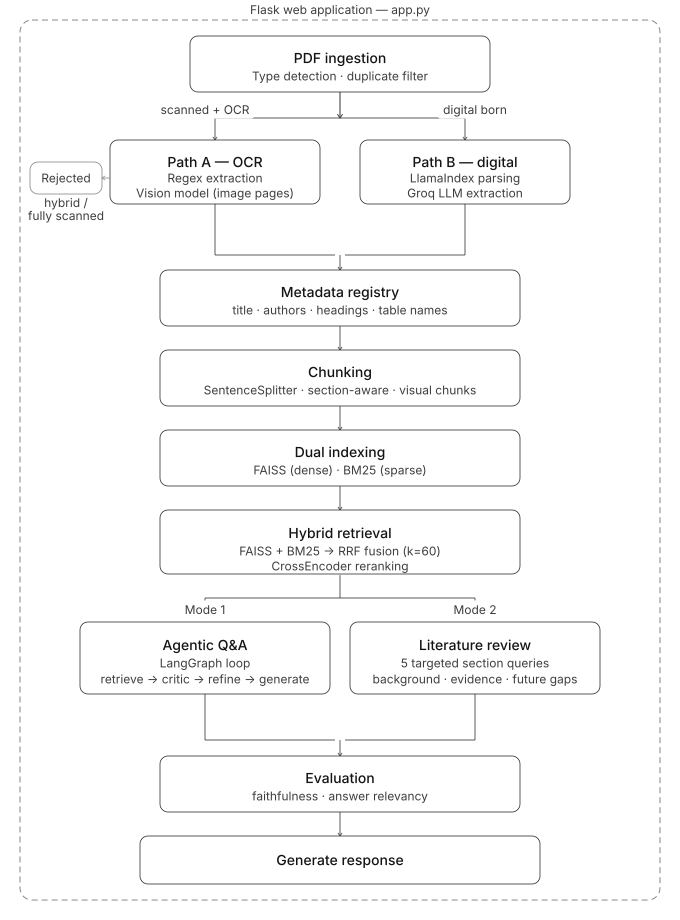
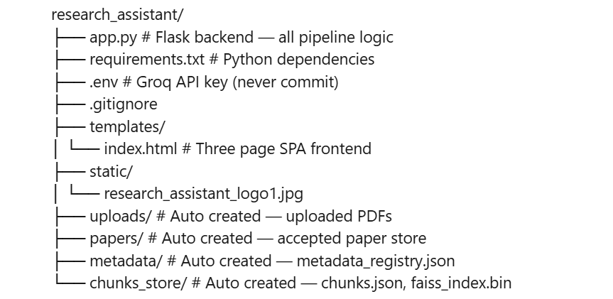
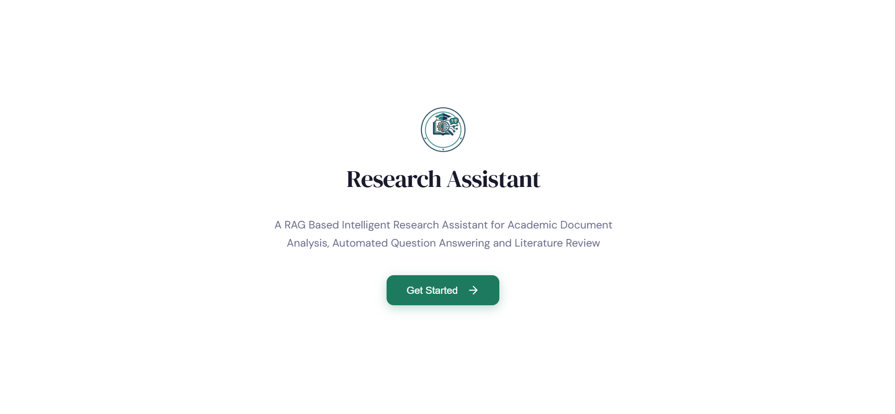
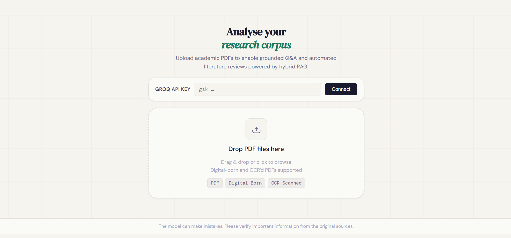
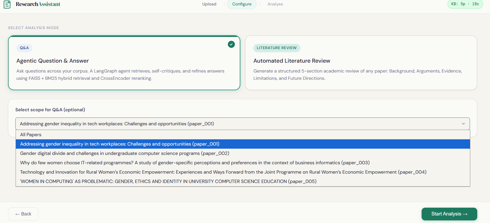
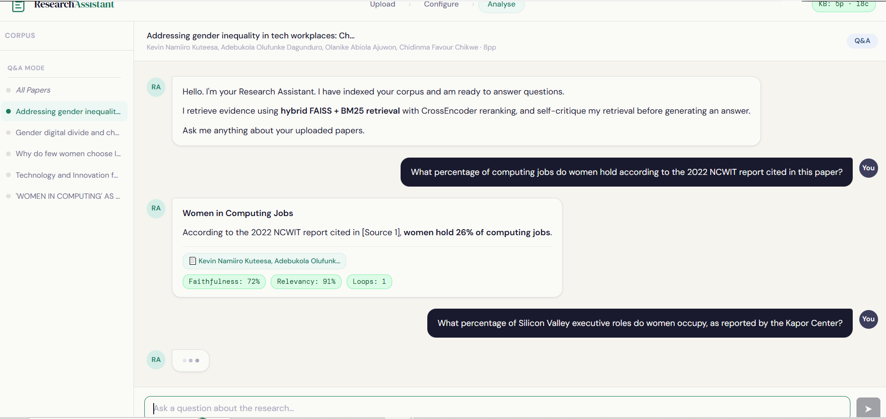
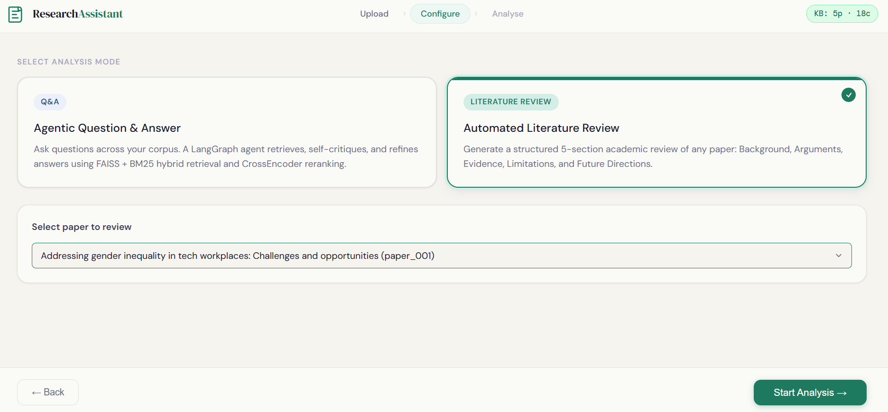
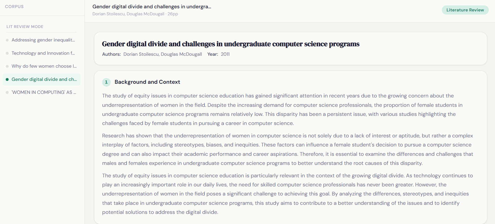

# A RAG Based Intelligent Research Assistant for Academic Document Analysis, Automated Question Answering and Literature Review Using Hybrid Retrieval

> An agentic, open source research assistant that lets users to upload their own academic PDF corpus and interact with it through grounded question answering and structured literature review generation - running entirely on free tools with no GPU required.

---

## Table of Contents

1. [Project Overview](#project-overview)
2. [System Architecture](#system-architecture)
3. [PDF Ingestion and Classification](#pdf-ingestion-and-classification)
4. [Dual Path Metadata Extraction](#dual-path-metadata-extraction)
5. [Document Type Acceptance Criteria](#document-type-acceptance-criteria)
6. [Section Aware Chunking](#section-aware-chunking)
7. [Embedding Model](#embedding-model)
8. [Dual Indexing - FAISS and BM25](#dual-indexing--faiss-and-bm25)
9. [Hybrid Retrieval with Reciprocal Rank Fusion](#hybrid-retrieval-with-reciprocal-rank-fusion)
10. [CrossEncoder Reranking](#crossencoder-reranking)
11. [Agentic Q&A Mode - Mode 1](#agentic-qa-mode--mode-1-langgraph-state-graph)
12. [Literature Review Mode - Mode 2](#literature-review-mode--mode-2-hallucination-safeguard)
13. [LLM API Used](#llm-api-used)
14. [Evaluation Metrics](#evaluation-metrics)
15. [Model Response Comparison](#model-response-comparison-vs-claude)
16. [Deployment Tools and Stack](#deployment-tools-and-stack)
17. [Project Structure](#project-structure)
18. [Installation and Setup](#installation-and-setup)
19. [How to Run](#how-to-run)
20. [Environment Variables](#environment-variables)
21. [Screenshots](#screenshots)
22. [References](#references)

---

## Project Overview

This project builds an end to end Agentic Retrieval Augmented Generation pipeline deployed as a Flask web application. It accepts a user uploaded collection of academic PDFs, classifies and processes them through a dual path extraction pipeline, indexes them using both dense and sparse retrieval methods, and supports two modes of scholarly interaction.

**Mode 1 - Agentic Q&A:** A LangGraph directed state graph that retrieves, self critiques, and refines answers before generating a response.

**Mode 2 - Literature Review:** Automatically generates a structured five section academic review of any single uploaded paper with an explicit hallucination safeguard on future directions.

The system uses the Groq API for LLM inference, runs on CPU only hardware, and requires no paid subscriptions beyond the free Groq tier.

---

## System Architecture



All pipeline components - embedding model, FAISS index, BM25 index, chunk corpus, and metadata registry are loaded into process memory at server startup and held for the lifetime of the server, eliminating cold start latency per request.

---

## PDF Ingestion and Classification

Every uploaded PDF is passed through `detect_pdf_type()` which samples up to 6 pages and computes four signals per page:

**Noise ratio** — proportion of non-standard OCR artefact characters:

$$\eta_i = \frac{|c \in T_i : c \in \Sigma_{noise}|}{|T_i|}$$

**Broken word ratio** — proportion of tokens of length ≤ 2:

$$\beta_i = \frac{|w \in W_i : |w| \leq 2|}{|W_i|}$$

**Short line ratio** — proportion of lines with character count between 0 and 8:

$$\sigma_i = \frac{|l \in L_i : 0 < |l| < 8|}{|L_i|}$$

**Full image flag** — true if any embedded image covers more than 50% of page area.

Document level classification:

| Type | Rule |
|---|---|
| FULLY SCANNED | scanned pages ≥ 70% |
| HYBRID | scanned > 25% and digital > 25% |
| SCANNED + OCR | OCR pages ≥ 30% |
| DIGITAL BORN | digital pages ≥ 60% |

SHA-256 hashing is applied to every file before processing for content level deduplication.

---

## Dual Path Metadata Extraction

### Path A - Scanned and OCR Pipeline

- Heading extraction via `ocr_extract_headings()` using four compiled regex patterns targeting Roman numeral headings, decimal headings, and known all-caps section names
- OCR corruption corrections: `H.` → `II.`, `n.` → `II.`, `m.` → `III.`
- Multi line heading merge strategy for split headings
- Table name extraction via `ocr_extract_table_names()` with five regex patterns across body text and vision extracted content
- Image page detection via `detect_image_pages()` — pages rendered to PNG at 2x resolution and submitted to `meta-llama/llama-4-scout-17b-16e-instruct` via Groq vision API
- Title and authors: Groq LLM first, regex fallback via `ocr_extract_title_authors()`

### Path B - Digital Born Pipeline

- LlamaIndex `SimpleDirectoryReader` for primary text extraction
- LlamaIndex output preferred over PyMuPDF if:

$$|T_{LlamaIndex}| \geq 0.9 \times |T_{PyMuPDF}|$$

- Heading extraction via Groq LLM - first 8,000 characters submitted with pipe delimited response format
- Same LLM first, regex fallback strategy for title and authors

Both paths share `call_llm()` backed by `llama-3.1-8b-instant` on Groq with exponential backoff retry up to 5 attempts.

---

## Document Type Acceptance Criteria

| Type | Accepted |
|---|---|
| DIGITAL BORN |  Accepted |
| SCANNED + OCR |  Accepted |
| FULLY SCANNED |  Rejected |
| HYBRID |  Rejected |

Rejected files are deleted from disk, their hash evicted from `seen_hashes`, and a rejection record returned to the frontend with a red badge. This gate prevents unextractable or noisy text from propagating into the knowledge base.

---

## Section Aware Chunking

`build_chunks()` segments each paper's text by heading occurrence through a linear scan, creating a `sections` dictionary mapping each heading to its body text. When no headings are available the full document is treated as a single `Full Text` section.

Each section is chunked using **LlamaIndex SentenceSplitter**:
chunk_size = 512 tokens
chunk_overlap = 64 tokens

The 64 token overlap ensures semantically coherent sentences spanning chunk boundaries are represented in both adjacent chunks.

Word based fallback if LlamaIndex unavailable:

$$chunk_k = W_{[\max(0,\; 450k-50)\; :\; 450(k+1)]}$$

Chunks under 20 tokens are discarded. Vision extracted image page content is appended as separate `source_type = "visual"` chunks, ensuring scanned tables remain searchable.

---

## Embedding Model

**Model:** `all-MiniLM-L6-v2` (SentenceTransformers)

- Produces 384 dimensional dense embedding vectors
- Encodes in batches of 32
- All embeddings L2 normalised before indexing:

$$\hat{e}_i = \frac{e_i}{\|e_i\|_2}$$

Chosen because it is lightweight, runs on CPU only, and produces strong semantic similarity representations without requiring GPU hardware — directly aligned with the project constraint of 8GB RAM.

---

## Dual Indexing - FAISS and BM25

### FAISS - Dense Index

`faiss.IndexFlatIP` - exact inner product similarity. Since all vectors are L2 normalised, inner product equals cosine similarity:

$$FAISS(q, k) = \underset{i}{\text{arg top-}k} \; q^\top \hat{e}_i = \cos(\theta_{qi})$$

Index persisted to `chunks_store/faiss_index.bin`.

### BM25 - Sparse Index

`BM25Okapi` over lowercased, whitespace tokenised chunk texts:

$$BM25(Q, d_j) = \sum_{i=1}^{m} IDF(q_i) \cdot \frac{f(q_i, d_j) \cdot (k_1 + 1)}{f(q_i, d_j) + k_1 \cdot \left(1 - b + b \cdot \frac{|d_j|}{avgdl}\right)}$$

With $k_1 = 1.5$, $b = 0.75$.

$$IDF(q_i) = \log \frac{N - n(q_i) + 0.5}{n(q_i) + 0.5}$$

BM25 captures exact lexical matching that dense retrieval misses - critical for humanities texts where theorist names and specialised terminology must be matched precisely.

---

## Hybrid Retrieval with Reciprocal Rank Fusion

Both indices are queried with an expanded candidate pool of `k' = 4k`. The two ranked lists are merged using **Reciprocal Rank Fusion**:

$$RRF(i) = \sum_{r \in \{\pi_{FAISS},\; \pi_{BM25}\}} \frac{1}{\kappa + rank_r(i)}$$

Where $\kappa = 60$ dampens the influence of top ranked documents. Chunks appearing in both lists accumulate contributions from both terms, naturally promoting cross index consensus.

Across all 10 test queries, RRF fusion consistently outperformed both FAISS alone and BM25 alone.

---

## CrossEncoder Reranking

**Model:** `cross-encoder/ms-marco-MiniLM-L-6-v2`

Unlike the bi-encoder used for FAISS, the CrossEncoder performs joint encoding of each query-chunk pair:

$$s_i = f_\theta(Q, c_i)$$

Producing a scalar relevance score per candidate. All candidates re-sorted by descending $s_i$ and final top-k returned.

Reranking is bypassed when `|R| ≤ k`. No fine tuning required - pre trained weights used directly, fitting within the 8GB RAM constraint.

Post rerank scores were substantially higher and showed greater variation than pre-rerank RRF scores across all test queries, confirming the CrossEncoder's ability to separate strongly relevant chunks from borderline ones.

---

## Agentic Q&A Mode - Mode 1 (LangGraph State Graph)

### Why LangGraph and not other frameworks?

| Framework | Reason not chosen |
|---|---|
| LangChain standard chains | Linear - no conditional branching or self critique loop |
| LlamaIndex query engine | No native state graph or retry logic |
| AutoGen / CrewAI | Multi agent - overkill for a single retrieval loop |
| Manual while loop | Unstructured, hard to extend or debug |

LangGraph was chosen because it allows the agentic loop to be expressed as a typed directed state graph with conditional edges, making the retrieve → critic → refine → generate cycle explicit, structured, and easy to extend.

### State Graph Topology


**QAState TypedDict fields:**
`question`, `paper_id`, `current_query`, `retrieved_chunks`, `sufficient`, `attempt`, `max_retries`, `answer`, `bibliography`, `sources_used`

**Retrieve node:** calls `HybridRetriever.retrieve()` with `top_k=5`

**Self critic node:** submits first 300 characters of each chunk to `llama-3.1-8b-instant` with binary YES/NO sufficiency prompt (`max_tokens=5`)

**Refine node:** submits original question and insufficiency signal to Groq, returns reformulated query (`max_tokens=60`)

**Generate node:** constructs structured context block from first 400 characters per chunk, generates academic answer using only provided sources (`max_tokens=800`)

Maximum retrieval executions bounded at 3:

$$|retrieve\ calls| \leq k_{max} + 1 = 3$$

---

## Literature Review Mode - Mode 2 (Hallucination Safeguard)

Five fixed section queries issued to `HybridRetriever.retrieve()` with `top_k=4`, scoped to the target paper:

| Section | Query |
|---|---|
| Background | background context history theory |
| Arguments | main arguments claims theoretical framework |
| Evidence | evidence examples cases data findings |
| Limitations | limitations problems criticism weaknesses |
| Future Directions | future research directions unresolved questions gaps |

### Hallucination Safeguard on Section 5

Before generating future directions, a verification LLM call is issued requesting only explicitly stated future research statements. If the response equals the sentinel `NONE_FOUND`, the section is replaced with:

> *"The paper does not explicitly state future research directions or gaps."*

This prevents the model from fabricating research agendas from its own training data - one of the most common failure modes of automated summarisation systems.

A fixed 3 second inter-call delay is enforced between all LLM generation calls to respect Groq API rate limits.

---

## LLM API Used

**Provider:** Groq  
**Model:** `llama-3.1-8b-instant`  
**Vision model:** `meta-llama/llama-4-scout-17b-16e-instruct` (image page extraction only)

Groq was chosen over OpenAI and Anthropic APIs because:
- Free tier available with generous token limits
- Extremely fast inference optimised for LLaMA models
- No GPU required locally - all heavy computation offloaded to Groq
- `llama-3.1-8b-instant` is capable enough for academic Q&A at minimal latency

`call_llm()` implements exponential backoff retry up to 5 attempts with parsed wait times from rate limit error responses.

---

## Evaluation Metrics

### Faithfulness

Measures how grounded the generated answer is in retrieved source chunks:

$$Faithfulness = \frac{1}{m} \sum_{j=1}^{m} \max_{i \in [n]} \cos(\hat{e}_{a_j},\; \hat{e}_{c_i})$$

Score close to 1.0 means every sentence in the answer has a closely matching passage in the retrieved sources.

### Answer Relevancy

Measures semantic alignment between question and answer:

$$Relevancy = \cos(\hat{e}_Q,\; \hat{e}_A) = \frac{e_Q \cdot e_A}{\|e_Q\|_2 \cdot \|e_A\|_2}$$

Both metrics computed using `all-MiniLM-L6-v2` embeddings and `sklearn cosine_similarity` — fully self contained with no additional API calls.

### Results Across 10 Test Queries

| Metric | Average Score |
|---|---|
| Faithfulness | 0.6802 |
| Answer Relevancy | 0.7275 |
| Query Latency | 11.25 seconds |

Score bands: **High** ≥ 0.75 / **Moderate** 0.60–0.74 / **Low** < 0.60

---

## Model Response Comparison (vs Claude)

Evaluated across 18 questions spanning 5 humanities papers. Claude generated responses used as reference answers.

| Model | Avg Faithfulness | Avg Answer Relevancy |
|---|---|---|
| Model 1 (Baseline) | — | — |
| Final Model | 0.6202 | 0.8380 |

**Key findings:**
- Final Model correctly retrieved the NCWIT 26% figure and Kapor Center 11% Silicon Valley executive roles figure where Model 1 failed on the latter
- Final Model correctly attributed the Kelly (2008) digital divide framework where Model 1 incorrectly cited Attewell (2001)
- Final Model retrieved Sturman's Foucauldian governmentality framing where Model 1 returned a null response
- Answer relevancy of 0.8380 confirms the system reliably produces responses that address the question asked

---

## Deployment Tools and Stack

| Layer | Tool |
|---|---|
| Backend | Flask (Python) |
| Production server | Gunicorn |
| LLM inference | Groq API (`llama-3.1-8b-instant`) |
| Embedding | SentenceTransformers `all-MiniLM-L6-v2` |
| Dense index | FAISS `IndexFlatIP` |
| Sparse index | `BM25Okapi` (rank-bm25) |
| Reranker | CrossEncoder `ms-marco-MiniLM-L-6-v2` |
| PDF parsing | PyMuPDF (fitz), LlamaIndex, pdfplumber |
| Vision extraction | Groq vision API (`llama-4-scout-17b-16e-instruct`) |
| Agentic loop | LangGraph StateGraph |
| Frontend | Vanilla JS, DM typeface, Marked.js v9.1.6 |
| Environment | python-dotenv |
| Hardware | CPU only, 8GB RAM |

---

## Project Structure



---

## Installation and Setup

```bash
git clone https://github.com/Rafa2208/RAG-Research-Assistant.git
cd RAG-Research-Assistant
python -m venv venv
venv\Scripts\activate        # Windows
pip install -r requirements.txt
```

Create a `.env` file in the root folder:
GROQ_API_KEY=your_groq_api_key_here

---

## How to Run

```bash
python app.py
```

Open your browser at `http://localhost:5000`

**Workflow:**
1. Enter your Groq API key and click Connect
2. Upload your academic PDFs
3. Select Q&A or Literature Review mode
4. Select scope - all papers or single paper
5. Ask questions or generate a literature review

---

## Environment Variables

| Variable | Description |
|---|---|
| `GROQ_API_KEY` | Your Groq API key from console.groq.com |

The key can also be entered at runtime through the web interface on Page 1 without needing a `.env` file.

---

## Screenshots

### Splash Screen


### API Configuration and PDF Upload


### Document Classification Results


### Mode 1 Selection


### Q&A Interaction with Evaluation Scores


### Mode 2 Selection


### Literature Review Output


---

## References

- Lewis et al. (2020), Retrieval Augmented Generation for Knowledge Intensive NLP Tasks
- Gao et al. (2023), RAG for Large Language Models: A Survey
- Karpukhin et al. (2020), Dense Passage Retrieval
- Es et al. (2023), RAGAS: Automated Evaluation of RAG
- Yao et al. (2022), ReAct: Synergizing Reasoning and Acting
- Asai et al. (2023), Self RAG
- Jiang et al. (2023), FLARE: Active Retrieval Augmented Generation
- Shao et al. (2023), ITER RETGEN
- Singh et al. (2025), Agentic RAG Survey
- Robertson and Zaragoza (2009), BM25 and Beyond
- Yu et al. (2024), RankRAG
- Jeong et al. (2024), Adaptive RAG
- Ali et al. (2024), Automated Literature Review using NLP and RAG
- Agarwal et al. (2024), LitLLM